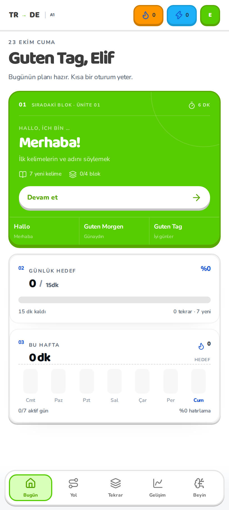
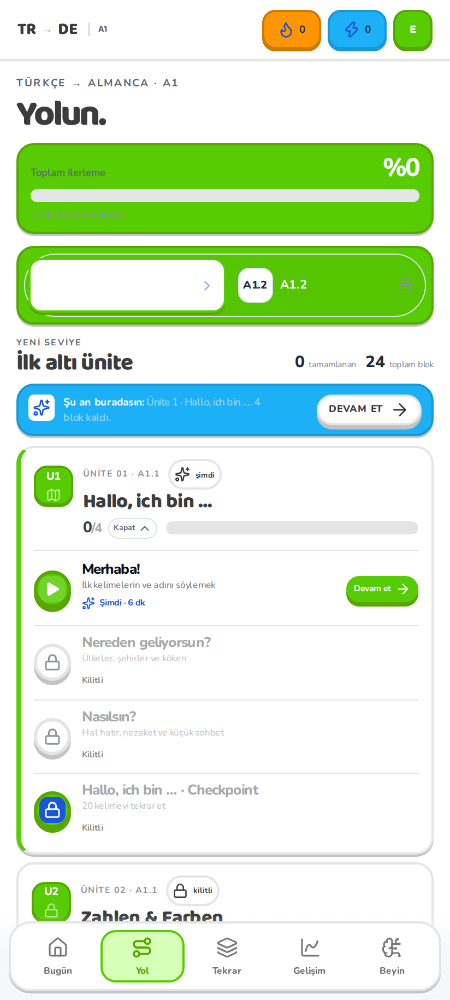
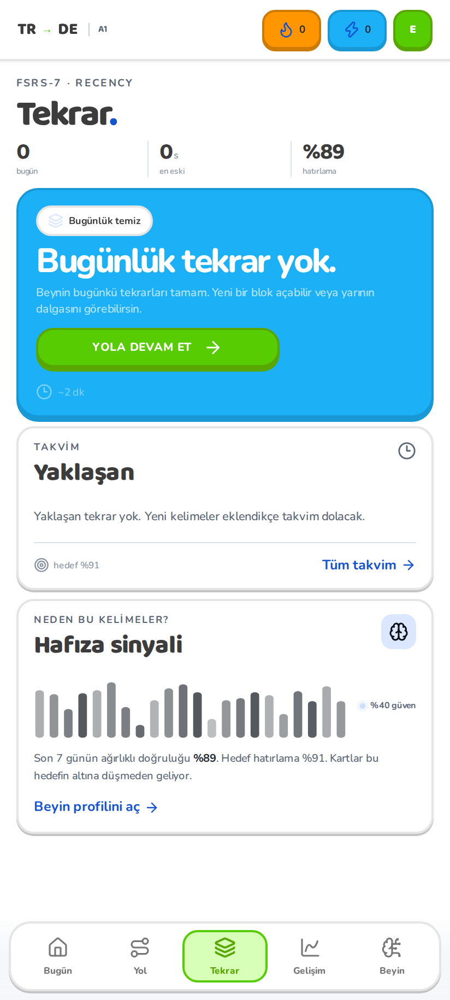
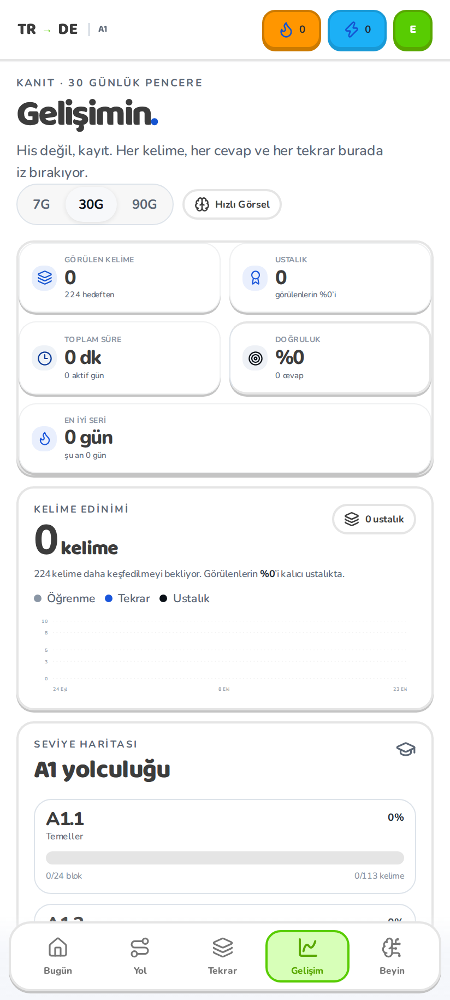
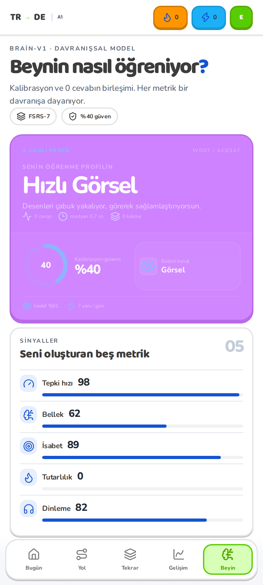
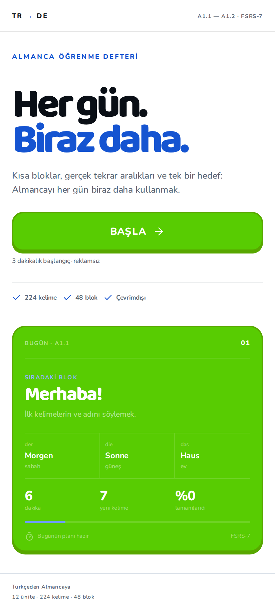
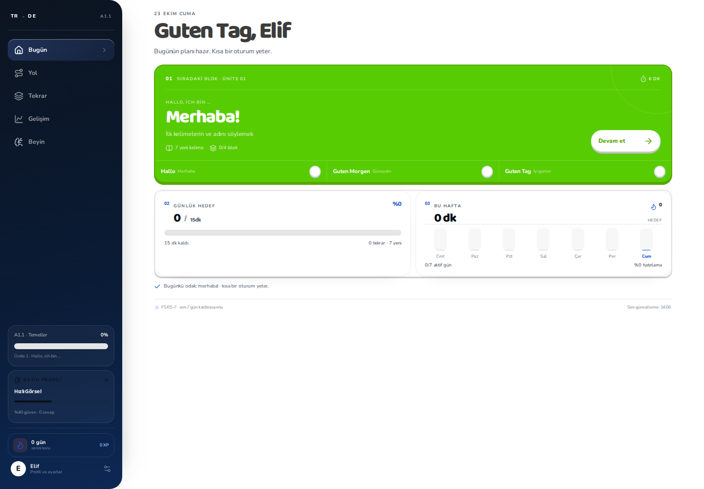

<p align="center">
  
</p>

<h1 align="center">wort.</h1>

<p align="center">
  <strong>Almanca, beynine göre.</strong><br />
  Türkçe → Almanca A1.1 / A1.2 öğrenme uygulaması · FSRS-7 · çevrimdışı Android
</p>

<p align="center">
  <a href="https://github.com/Baran3575/AnkiLanguage/actions/workflows/android.yml"></a>
  
  
  
  
</p>

**wort.**, günde 10–15 dakikada Almanca öğrenmek için tasarlanmış, Türkçe arayüzlü bir A1 uygulaması. Dersler kelime blokları hâlinde ilerler; tekrar zamanlaması gerçek FSRS-7 hafıza modeli ve son 7 günün performansını izleyen bir recency katmanıyla hesaplanır.

Uygulama iki modda çalışır:

- **Web / API modu** — Express + SQLite. Veriler `data/wort.db` içinde tutulur.
- **Mobil / çevrimdışı mod** — Capacitor WebView + sürümlü `localStorage`. Sunucu, internet veya API gerekmez. Android APK bu modda derlenir.

## Ekranlar

<p align="center">
  
  
  
</p>

<p align="center">
  
  
  
</p>

<p align="center">
  
</p>

## Sürüm 2.0.0

- **FSRS-7 · Recency** · 34 parametreli çift-stabilite modeli; uzun vadeli `stability`, kısa vadeli `stability_short` ve `difficulty` birlikte güncellenir.
- **Güvenilir Almanca ses** · Android'de yerel `TextToSpeech` motoru, Google Almanca ses paketleri arasında deterministik kalite sıralaması ve web için `speechSynthesis` yedeği.
- **Edge-to-edge Android** · Android 17 / API 37 hedefi, Android 9 / API 28 desteği, `EdgeToEdge.enable()` ve `SystemBars` CSS güvenli alanları.
- **Yeni görsel sistem** · Duolingo esintili, oyunlaştırılmış arayüz: Feather/Baloo tarzı yuvarlak tipografi, 3D butonlar, yeşil aksan, yol baloncukları, ilerleme çubukları ve yalnızca gerçek durum verileri.
- **Doğrulanmış A1 içeriği** · 12 ünite, 48 blok, 224 kelime; dil bilgisi notları ve örnek cümleler gözden geçirildi.

## Özellikler

- **A1.1 ve A1.2** · 12 ünite, 36 ders + 12 checkpoint, 224 kelime.
- **Kelime blokları** · eşleştirme, çoktan seçmeli tanıma, dinleme, yazma, artikel, cümle kurma ve boşluk doldurma.
- **Bugün** · günlük hedef, sıradaki blok, seri, tekrar yükü ve haftalık plan.
- **Yol** · A1.1 → A1.2 geçişi, kilitli/açık/tamamlanmış bloklar, üniteler ve checkpoint'ler.
- **Tekrar** · FSRS-7 destesi, gecikmiş kelimeler, yaklaşan yük grafiği ve dört dereceli değerlendirme.
- **Gelişim + Beyin** · kelime edinimi, doğruluk, seri, ısı haritası, öğrenme profili ve kişiselleştirme.
- **Çevrimdışı kalıcılık** · API modunda SQLite; mobil modda `wort.local.v1` anahtarında yerel durum.
- **Kompakt akış** · Bugün ve Tekrar tek ekrana yakın; Yol ekranında yalnızca güncel ünite açık başlar, diğer üniteler katlanır.

## FSRS-7 · Recency

Zamanlayıcı [`shared/fsrs.js`](shared/fsrs.js) içinde tek bir saf JavaScript modülü olarak yaşar. Aynı kod tarayıcıda, çevrimdışı Android motorunda ve Node API'sinde çalışır.

### Hafıza modeli

- 34 parametreli FSRS-7 çift-stabilite modeli.
- Her kelime için `stability`, `stability_short`, `difficulty`, `reps`, `lapses`, son tekrar ve sonraki tekrar tarihi saklanır.
- Hatırlama olasılığı, kısa vadeli ve uzun vadeli unutma eğrilerinin ağırlıklı birleşimidir.
- Başarılı tekrarlarda kararlılık artar; unutmalarda `difficulty` yükselir ve kelime kısa süre sonra geri gelir.
- Hedef hatırlama aralığı %87–%94 bandındadır; kullanıcı profili bu hedefi dar biçimde kalibre eder.

### Recency katmanı

- Son 21 günün doğruluğu, gecikmesi ve unutma oranı **7 günlük yarı ömürlü** üstel ağırlıkla hesaplanır.
- Son performans, kararlılık çarpanını yalnızca **0.95–1.025** aralığında ayarlar.
- Tekrar birikmesi hedef hatırlamayı hafifçe düşürür; sık unutma hedefi yükseltir.
- İlk başarılı karşılaşma 24 saat sonra, unutulan kart 10 dakika sonra yeniden gelir.
- Tüm hesaplar deterministiktir ve cihaz üzerinde yapılır.

### Testler

```bash
npm test
```

FSRS testleri; ilk karşılaşma, başarılı tekrar, unutma, önizleme aralıkları, recency ağırlıkları ve geçersiz tarih/girdi durumlarını kapsar.

## Mimari

```text
src/                 React 19 arayüzü
  screens/           Bugün, Yol, Tekrar, Gelişim, Beyin, Ders
  components/        Ortak UI parçaları, sayfalar ve grafikler
  lib/speech.js      Yerel Android TTS + web fallback
  local/engine.js    Çevrimdışı API + localStorage motoru
shared/              İçerik, FSRS-7, egzersiz ve profil mantığı
server/              Express API + node:sqlite
android/             Capacitor Android projesi
.github/workflows/   GitHub Actions APK derlemesi
```

- Web: Vite 8 + React 19.
- API: Node 22'nin yerleşik `node:sqlite` modülü.
- Android: Capacitor 8, `com.baran.wort`, **minSdk 28**, **compileSdk / targetSdk 37**.
- Android derlemesi: AGP **9.2.0**, Gradle **9.4.1**, Java 21.
- Mobil derlemede `VITE_LOCAL_MODE=true` kullanılır; bütün durum cihazda `wort.local.v1` anahtarında saklanır.

## Yerel geliştirme

Gereksinim: **Node.js 22+**.

```bash
npm install

# API + web (http://localhost:5173)
npm run dev

# Yalnızca web / çevrimdışı mod (http://localhost:5174)
npm run dev:local

# Üretim derlemesi
npm run build

# Testler
npm test
```

API sunucusunu ayrı çalıştırmak için:

```bash
npm run server
```

SQLite dosyası ilk çalıştırmada `data/wort.db` olarak oluşturulur. İlerlemeyi sıfırlamak için **Ayarlar → İlerlemeyi sıfırla** akışını kullanabilirsiniz.

## Android APK

APK, `main` dalına yapılan her push sonrası GitHub Actions'ta üretilir. Yayınlanmış sürümler **[Releases · wort.](https://github.com/Baran3575/AnkiLanguage/releases)** sayfasındadır.

### GitHub Actions ile (önerilen)

`main` dalına yapılan her push (veya manuel **Run workflow**) APK üretir:

1. **Actions → Build Android APK** çalışmasını açın.
2. **Artifacts → wort-android-debug** dosyasını indirin.
3. `app-debug.apk` dosyasını Android 9 veya üzeri bir telefona kurun.

İş akışı Node 22, Java 21 ve Android SDK 37 kurar; çıktının SHA-256 özetini loglara yazar.

### Yerelde derleme

Android SDK 37, JDK 21 ve Android Studio komut satırı araçları gerekir:

```bash
npm ci
npm run build:android
npx cap sync android
cd android && ./gradlew assembleDebug
```

APK: `android/app/build/outputs/apk/debug/app-debug.apk`

> Bu depodaki APK **debug** olarak imzalanır; geliştirme ve doğrudan kurulum içindir. Mağaza dağıtımı için kendi release keystore'unuzla imzalanmış bir AAB/APK üretmelisiniz.

## Ses ve güvenli alan notları

- Android'de ses, `@capacitor-community/text-to-speech` üzerinden platformun yerel motoruna gider. WebView'in güvenilmez `speechSynthesis` yolu yalnızca yedektir.
- Almanca ses seçimi `de-DE` yerel paketleri önceler; Google `deg > deb > nfh > dea` sırası izlenir ve ağ sesleri geri planda tutulur.
- Ayarlar → **Almanca ses** bölümü seçilen sesi, hazırlık durumunu ve gerekirse ses paketi yükleyiciyi gösterir.
- Android 15+ edge-to-edge zorunluluğu için `MainActivity` içinde `EdgeToEdge.enable(this)` çağrılır.
- `SystemBars` `insetsHandling: "css"` ile `--safe-area-inset-*` değerlerini enjekte eder; arayüz bunları `--safe-top/right/bottom/left` üzerinden tüketir. `viewport-fit=cover` etkin.

## Veri ve gizlilik

- Mobil modda hiçbir veri cihazdan çıkmaz; hesap, reklam veya analitik yoktur.
- Web/API modunda veriler yalnızca yerel SQLite dosyasında tutulur.
- FSRS-7 tamamen cihaz üzerinde hesaplanır.

## Lisans

MIT — bkz. [LICENSE](LICENSE).
