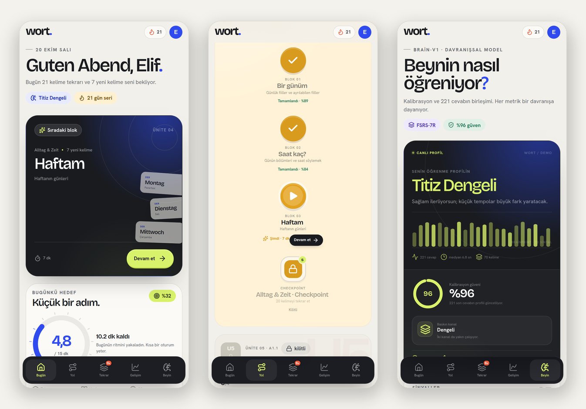

<p align="center">
  
</p>

<h1 align="center">wort.</h1>

<p align="center">
  <strong>Almanca, beynine göre.</strong><br />
  Türkçe → Almanca A1.1 / A1.2 öğrenme uygulaması · çevrimdışı Android APK
</p>

<p align="center">
  <a href="https://github.com/Baran3575/AnkiLanguage/actions/workflows/android.yml"></a>
  
  
  
</p>

<p align="center">
  
</p>

**wort.**, günlük 10–15 dakikada Almanca öğrenmek için tasarlanmış, Türkçe arayüzlü bir A1 uygulaması. Dersler kelime blokları hâlinde ilerler; tekrar zamanlaması öğrencinin hızına, gecikmesine ve son 7 günlük performansına göre uyarlanır.

Uygulama iki modda çalışır:

- **Web / API modu** — Express + SQLite. Kalıcı veri `data/wort.db` içinde tutulur.
- **Mobil / çevrimdışı mod** — Capacitor WebView + `localStorage`. Sunucu, internet veya API gerekmez. Android APK bu modda derlenir.

## Özellikler

- **A1.1 ve A1.2** · 12 ünite, 48 öğrenme bloğu, 224 kelime ve 12 checkpoint.
- **Kelime blokları** · okuma, eşleştirme, boşluk doldurma, çeviri, cinsiyet/artikel ve telaffuz egzersizleri.
- **Bugün ekranı** · günlük hedef, sıradaki blok, seri, tekrar yükü, haftalık plan ve kelime hazinesi özeti.
- **Yol haritası** · kilitli/açık/tamamlanmış düğümler, ünite ilerlemesi, checkpoint'ler ve A1.1 → A1.2 geçişi.
- **Tekrar merkezi** · FSRS-7R ile sıralanan tekrar destesi, gecikmiş kelimeler ve yaklaşan yük grafiği.
- **Gelişim + Beyin** · CEFR bazında kelime, doğruluk, seri, ısı haritası, öğrenme profili ve kişiselleştirme ayarları.
- **Kalıcı veri** · API modunda SQLite; mobil modda sürümlü `localStorage` durumu.
- **Demo profili** · 20 günlük geçmiş, 70 görülmüş kelime, 15 ustalaşılmış kelime ve 21 günlük seri ile hazır gelir.

## FSRS-7R · Recency

Bu projedeki **FSRS-7R**, resmî FSRS-7 algoritması değildir. Adı ürün içinde kullanılan sürüm etiketidir. Uygulanan model, FSRS-5'in kararlılık/zorluk güncellemelerini temel alır ve üzerine **7 günlük geriye dönük performans düzeltmesi** ekler:

- Her kelime için kararlılık (`stability`), zorluk (`difficulty`), son tekrar ve sonraki tekrar tarihi tutulur.
- Cevap kalitesi (1–4), gecikme süresi ve hedef hatırlama oranı FSRS-5 formülleriyle yeni aralığı belirler.
- Son 7 gündeki doğruluk, ortalama tepki süresi ve kaçırılan tekrarlar bir **recency çarpanı** üretir.
- Çarpan, aralığı kısaltır veya uzatır; kullanıcı profili (temkinli/dengeli/cesur) hedef hatırlama oranını kaydırır.
- Tüm hesaplar deterministik ve çevrimdışıdır; sunucuya bağlı değildir.

Kodun tek kaynağı [`shared/fsrs.js`](shared/fsrs.js). Öğrenme profili ve egzersiz seçimi [`shared/brain.js`](shared/brain.js), içerik ve yol haritası [`shared/content.js`](shared/content.js) içindedir.

## Mimari

```text
src/                 React 19 arayüzü
  screens/           Bugün, Yol, Tekrar, Gelişim, Beyin, Ders
  components/        Ortak UI parçaları ve grafikler
  local/engine.js    Çevrimdışı API + localStorage motoru
shared/              İçerik, FSRS-7R, egzersiz ve profil mantığı
server/              Express API + node:sqlite
android/             Capacitor Android projesi
.github/workflows/   GitHub Actions APK derlemesi
```

- Web geliştirme: Vite 8 + React 19.
- API: Node 22'nin yerleşik `node:sqlite` modülü; ek veritabanı sunucusu yok.
- Android: Capacitor 8, `com.baran.wort`, min SDK 24, target SDK 36.
- Mobil derlemede `VITE_LOCAL_MODE=true` kullanılır. Bu modda bütün durum cihazda `wort.local.v1` anahtarında saklanır.

## Yerel geliştirme

Gereksinim: **Node.js 22+**.

```bash
npm install

# API + web (http://localhost:5173)
npm run dev

# Yalnızca web / çevrimdışı mod (http://localhost:5174)
npm run dev:local

# Üretim derlemesi
npm run build
```

API sunucusunu ayrı çalıştırmak için:

```bash
npm run server
```

SQLite dosyası ilk çalıştırmada `data/wort.db` olarak oluşturulur. Demo profilini sıfırlamak için arayüzdeki **Ayarlar → İlerlemeyi sıfırla** akışını kullanabilirsiniz.

## Android APK

### GitHub Actions ile (önerilen)

`main` dalına yapılan her push (veya manuel **Run workflow**) APK üretir:

1. **Actions → Build Android APK** çalışmasını açın.
2. **Artifacts → wort-android-debug** dosyasını indirin.
3. `app-debug.apk` dosyasını Android telefonunuza kurun. Bilinmeyen kaynaklardan kurulum izni gerekebilir.

İş akışı Node 22, Java 21 ve Android SDK 36 kullanır; çıktının SHA-256 özetini de loglara yazar.

### Yerelde derleme

Android SDK 36, JDK 21 ve Android Studio komut satırı araçları gerekir:

```bash
npm ci
npm run build:android
npx cap sync android
cd android && ./gradlew assembleDebug
```

APK: `android/app/build/outputs/apk/debug/app-debug.apk`

> Bu depodaki APK **debug** olarak imzalanır; geliştirme ve doğrudan kurulum içindir. Mağaza dağıtımı için kendi release keystore'unuzla imzalanmış bir AAB/APK üretmelisiniz.

## Veri ve gizlilik

- Mobil modda hiçbir veri cihazdan çıkmaz; hesap, reklam veya analitik yoktur.
- Web/API modunda veriler yalnızca yerel SQLite dosyasında tutulur.
- FSRS-7R tamamen cihaz üzerinde hesaplanır.
- Demo profili gerçek bir kullanıcı verisi içermez.

## Lisans

MIT — bkz. [LICENSE](LICENSE).
